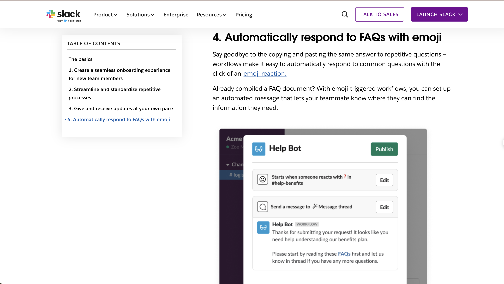
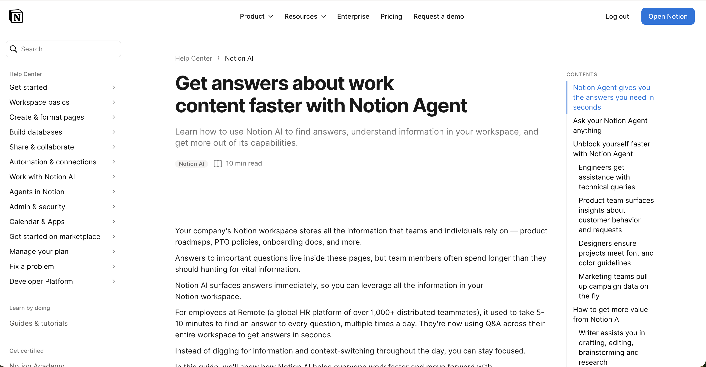
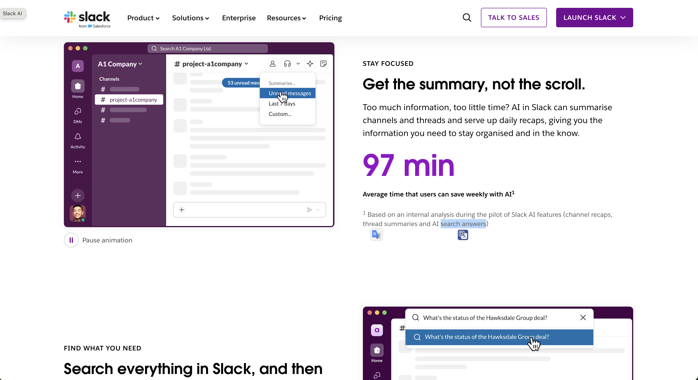

# Ghi chú Research giải pháp đã có (CP4)

- **Người thực hiện:** Nguyễn Quang Đạo (`2A202603614`)
- **Người hỗ trợ:** Nguyễn Văn Ngọc Sơn (`2A202603600`)
- **Bài toán đối chiếu (Candidate #5):** Khi đồng nghiệp hoặc bạn học hỏi lại một câu đã được trả lời, người được hỏi phải giải thích lại từ đầu, khoảng 2 lần/tuần và phổ biến khoảng 15–30 phút mỗi lần.

---

## 1. Slack Workflow Builder — Trả lời FAQ tự động bằng Emoji

- **Link gốc đã kiểm chứng:** https://slack.com/resources/using-slack/4-simple-ways-to-save-time-with-workflow-builder
- **Mục đối chiếu trên trang:** Mục *4. Automatically respond to FAQs with emoji*
- **Trích dẫn nguyên văn từ trang khi mở kiểm tra:**
  > *"Say goodbye to the copying and pasting the same answer to repetitive questions – workflows make it easy to automatically respond to common questions with the click of an emoji reaction."*
  > *"Already compiled a FAQ document? With emoji-triggered workflows, you can set up an automated message that lets your teammate know where they can find the information they need."*
- **Phân tích cho bài toán của nhóm:**
  - **Giải quyết bước nào:** Bước trả lời lặp lại — thay vì gõ giải thích lại từ đầu hoặc đi tìm link cũ để dán, người trong nhóm chỉ cần thả một emoji (ví dụ `❓`) vào tin nhắn câu hỏi, workflow sẽ tự phản hồi trong thread kèm đường dẫn tới tài liệu FAQ.
  - **Điều kiện tiên quyết / Khoảng trống:** Ngay trong câu mở đầu (*"Already compiled a FAQ document?"*), Slack khẳng định nhóm **phải biên soạn sẵn tài liệu FAQ trước**. Ngoài ra, tính năng này chỉ hoạt động nếu cả nhóm giao tiếp trên Slack gói có hỗ trợ Workflow Builder.
  - **Bài học rút ra:** Đây là minh chứng điển hình cho mức **No AI** (có tài liệu FAQ) và mức **Rule** (gắn emoji kích hoạt tin nhắn mẫu). Khi nhóm chưa có tài liệu FAQ, việc cấu hình tự động hóa chưa giải quyết được gốc rễ.

### Ảnh chụp màn hình đối chiếu

---

## 2. Notion Q&A (hiển thị trên trang là Notion Agent / Notion AI)

- **Link gốc đã kiểm chứng:** https://www.notion.com/help/guides/get-answers-about-content-faster-with-q-and-a
- **Tiêu đề thực tế khi mở trang:** *Get answers about work content faster with Notion Agent*
- **Trích dẫn nguyên văn từ trang khi mở kiểm tra:**
  > *"Your company's Notion workspace stores all the information that teams and individuals rely on — product roadmaps, PTO policies, onboarding docs, and more. Answers to important questions live inside these pages, but team members often spend longer than they should hunting for vital information."*
  > *"For employees at Remote (a global HR platform of over 1,000+ distributed teammates), it used to take 5-10 minutes to find an answer to every question, multiple times a day. They're now using Q&A across their entire workspace to get answers in seconds."*
- **Phân tích cho bài toán của nhóm:**
  - **Giải quyết bước nào:** Bước người hỏi tự tìm câu trả lời trong kho tài liệu chung trước khi nhắn hỏi đồng nghiệp.
  - **Điều kiện tiên quyết / Khoảng trống:** Công cụ chỉ trích xuất được câu trả lời khi thông tin **đã nằm sẵn trong các trang Notion** (*"Answers to important questions live inside these pages"*) và người hỏi có quyền truy cập vào trang đó. Nếu kiến thức vẫn chỉ nằm trong đầu người được hỏi hoặc rải rác trong tin nhắn cá nhân, Notion Agent không thể trả lời đúng.
  - **Bài học rút ra:** Ngay cả khi dùng tới giải pháp **Workflow / Agent có AI**, bước nền tảng bắt buộc vẫn là ghi chép các câu trả lời lặp lại thành tài liệu chuẩn. Với quy mô nhóm học tập và làm việc nhỏ (chỉ có khoảng 5–10 câu hỏi lặp đi lặp lại nhiều nhất), một trang FAQ gọn gàng đã giúp người hỏi tra cứu trực tiếp mà chưa cần mua gói Notion AI.

### Ảnh chụp màn hình đối chiếu

---

## 3. Slack AI — Tìm kiếm có câu trả lời (AI Search Answers)

- **Link gốc đã kiểm chứng:** https://slack.com/intl/en-au/features/ai
- **Trích dẫn nguyên văn và chú thích chân trang (footnote) khi mở kiểm tra:**
  > *"97 min — Average time that users can save weekly with AI¹"*
  > *"¹ Based on an internal analysis during the pilot of Slack AI features (channel recaps, thread summaries and AI search answers)"*
- **Phân tích cho bài toán của nhóm:**
  - **Giải quyết bước nào:** Bước lục tìm lại câu trả lời cũ trong lịch sử tin nhắn và kênh trò chuyện (*AI search answers*).
  - **Điều kiện tiên quyết / Khoảng trống:**
    1. Con số tiết kiệm *97 phút/tuần* đi kèm chú thích số `1` ghi rõ đây là **phân tích nội bộ của chính Slack trong đợt pilot** (*internal analysis during the pilot of Slack AI features*), gộp chung cả tóm tắt kênh, tóm tắt luồng chat và tìm kiếm, không phải số đo độc lập riêng cho việc trả lời câu hỏi lặp lại.
    2. Tính năng thuộc gói trả phí bổ sung của Slack, không phù hợp với nhóm sinh viên hoặc nhóm làm việc dùng công cụ miễn phí / đa nền tảng (Zalo, Messenger, Discord).
  - **Bài học rút ra:** Không dùng số liệu quảng cáo của nhà cung cấp làm baseline hay target cho nhóm. Về mặt kỹ thuật, tìm kiếm AI trên lịch sử chat cũ có rủi ro lấy nhầm câu trả lời đã lỗi thời nếu không có một trang FAQ chính thức được người phụ trách rà soát định kỳ.

### Ảnh chụp màn hình đối chiếu

---

## 4. Kết luận tổng hợp từ Research (Đầu vào cho CP5 & CP6)

1. **Điểm chung của cả 3 giải pháp:** Mọi công cụ từ mức **Rule** (Slack Workflow Builder) đến mức **AI** (Notion Agent, Slack AI) đều phụ thuộc vào việc **nhóm đã có sẵn nguồn câu trả lời chuẩn (FAQ / tài liệu được cập nhật) hay chưa**.
2. **Tác động tới quyết định của nhóm abc404:**
   - Thay vì vội vàng xây dựng chatbot hay workflow RAG khi chưa có dữ liệu nguồn và chưa biết đồng nghiệp/bạn học có chịu tự tra cứu hay không (Giả định #3), nhóm quyết định chọn mức **No AI**: viết một trang FAQ gồm 5 câu hỏi hay bị hỏi lại nhất, ghim lên kênh chung và chạy pilot trong 2 tuần để đo hành vi thực tế.

